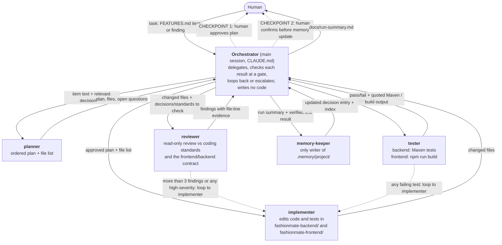

# Orchestration Diagram: FashionMate App Change Workflow

Version: 1.0.0 (2026-10-19). Design spec for the orchestrated workflow; agent definitions and the routing-and-tool-grant map follow from it.

**App:** FashionMate: React frontend (`fashionmate-frontend/fashion-app/`) + Spring Boot backend (`fashionmate-backend/`).
**Workflow:** one `FEATURES.md` item or review finding, frontend, backend, or both, goes plan → implement → review → test → record memory.
**Roles:** 5 subagents (planner, implementer, reviewer, tester, memory-keeper) coordinated by the Orchestrator (the main Claude Code session, configured in `CLAUDE.md`).

**Alt text:** A top-down flowchart. The Human gives the Orchestrator a task (a FEATURES.md item or review finding). The Orchestrator sends the item and relevant decision IDs to the planner, which returns a plan, file list, and open questions; the Orchestrator then pauses for the human to approve the plan (checkpoint 1). The approved plan goes to the implementer, which returns changed files. The implementer may change the backend, the frontend, or both. The changed files go to the reviewer, which checks them against the coding standards and the frontend/backend API contract (decision-008) and returns findings with file:line evidence, and to the tester, which runs the backend Maven tests and/or the frontend production build and returns pass/fail with quoted output. Dashed loop-back arrows go from the reviewer (more than three findings or any high-severity) and from the tester (any failing test) back to the implementer. Before updating memory, the Orchestrator pauses for human confirmation (checkpoint 2), then sends the run summary and verified test result to the memory-keeper, which returns the updated decision entry and index. The Orchestrator finally writes docs/run-summary.md for the human.

## What passes on each arrow

| From → To | Handoff contents |
|---|---|
| Human → Orchestrator | The task: one FEATURES.md item or review finding |
| Orchestrator → planner | Item text, repo path, IDs of relevant decisions (from MEMORY_INDEX.md) |
| planner → Orchestrator | Numbered plan (smallest change first), files to change, open questions |
| Orchestrator → implementer | The human-approved plan and file list |
| implementer → Orchestrator | Changed files (paths) and a short summary |
| Orchestrator → reviewer | Changed files plus the coding standards and decisions to check against, including the frontend/backend contract (decision-008) whenever a controller response or a `fetch` call changes |
| reviewer → Orchestrator | Findings with severity, file:line, and quoted evidence |
| Orchestrator → tester | Changed files, and which side(s) changed (backend, frontend, or both) |
| tester → Orchestrator | Backend: exact Maven counts (run, failures, errors) and quoted failures. Frontend: `npm run build` exit code and quoted errors/warnings |
| Orchestrator → memory-keeper | Run summary plus the *verified* test result (after checkpoint 2) |
| memory-keeper → Orchestrator | Updated decision entry and MEMORY_INDEX.md line |
| Orchestrator → Human | `docs/run-summary.md`: what was built, review outcome, test outcome, memory updated |

## Gates and checkpoints

- **Checkpoint 1 (human):** approve the plan before any code is written.
- **Review gate:** more than 3 findings, or any high-severity finding, loops back to the implementer, then the reviewer re-runs.
- **Test gate:** any failing test loops back to the implementer, then the tester re-runs.
- **Halt and escalate:** the same gate failing twice in a row stops the run and reports to the human.
- **Checkpoint 2 (human):** confirm before the memory-keeper writes to `.memory/project/`, so memory never records an unverified result (CLAUDE.md verification-status rule).

## Tool wiring

The planner and reviewer call the course **coursetools MCP server** (`.mcp.json`, `mcp/coursetools_server.py`) with `mcp__coursetools__file_read` / `mcp__coursetools__codebase_search`, passing their role; the server's allow-list (`mcp/roles.allowlist.json`) refuses any tool a role isn't granted. The other roles use Claude Code built-in tools. Full grants: `docs/routing-and-tool-grant-map.md`.

## Project-specific constraint

- **Backend tests:** the dev container has no JDK (decision-003), so the tester can't run Maven inside it yet. Until a JDK is added, the tester asks the human to run the PowerShell Docker command and reports from the pasted output.
- **Frontend build:** `npm run build` in `fashionmate-frontend/fashion-app` (the existing frontend-build-verifier agent's job; see `docs/prd.md`). The known Rollup optional-dependency failure is handled by that agent's one-time remediation.
- **Cross-side changes:** if a backend response shape or a frontend `fetch` call changes, the plan must cover both sides in the same run (decision-008).
